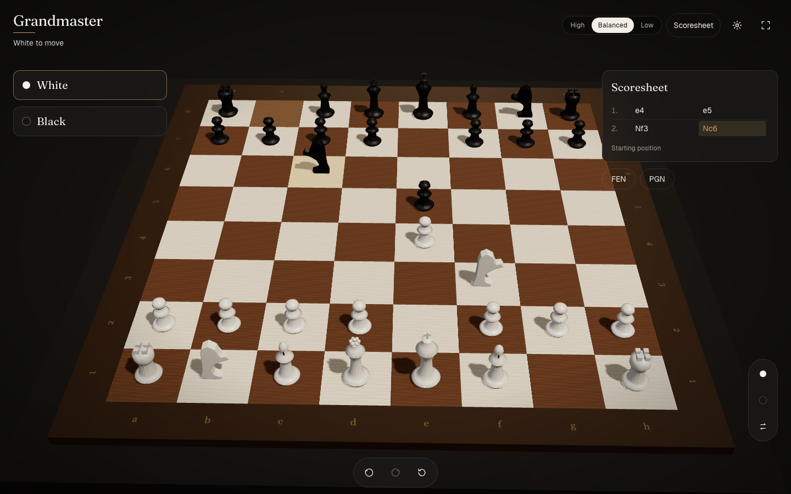

# ♟ Grandmaster 3D

Local 3D chess for two people, or against a small search opponent. The board fills the window, [chess.js](https://github.com/jhlywa/chess.js) is the rules authority, and the overlay stays out of the way.

[Play it](https://basugm.github.io/3D-Chess/)



## ✨ Highlights

- Two people can play on one screen. The board can turn to face the side to move.
- Easy, Medium, and Hard are a local search. You pick the color you play.
- Move by click, drag, or the keyboard. Illegal squares stay quiet.
- Promotion cannot be skipped. Mate, stalemate, and insufficient material end the game. Threefold repetition and the fifty-move rule open a claim.
- Pieces are procedural Staunton meshes. The canvas draws a frame when something changes, and sits idle when the board is still.

## 🧰 Stack

- **Next.js and React** render the single page and the overlay.
- **TypeScript** types the game data, the squares, and the scene.
- **Tailwind** styles the dock, the scoresheet, and the settings.
- **React Three Fiber and Three.js** draw the board, the lights, and the pieces.
- **Zustand** keeps the game in one store and the settings in another.
- **chess.js** decides what is legal.

The versions and the choices left out on purpose are in [docs/stack.md](docs/stack.md).

## 🏗️ How it is built

- [`lib/chess/engine.ts`](lib/chess/engine.ts) is the only module that applies a move. It lists legal moves and reports check, mate, stalemate, insufficient material, threefold repetition, and the fifty-move rule.
- [`lib/chess/pieceDiff.ts`](lib/chess/pieceDiff.ts) also constructs a `Chess` instance, and only to read the board when it assigns a stable id to each piece. Meshes slide, castle, capture, and promote without remounting.
- Settings are the only `localStorage` data. The game itself is not saved.
- [`components/scene/ChessScene.tsx`](components/scene/ChessScene.tsx) renders on demand. When nothing is animating, the canvas is idle.

The move path, the search, and the tests are in [docs/architecture.md](docs/architecture.md).

## ▶️ Run locally

```bash
npm run dev        # http://localhost:3000
npm run build      # production build
npm run start      # serve the production build
npm run lint
npm test           # unit and component tests
npm run test:e2e   # Playwright, desktop Chromium
```

`test:e2e` starts the dev server on port 3000 when one is not already running.

## ⌨️ Controls

| Action | Pointer | Keyboard |
| --- | --- | --- |
| Select a piece | Click it | Arrows, then Enter |
| Move | Click or drag onto a legal square | Enter on the destination |
| Cancel | Click empty board | Esc |
| Undo / redo | Dock buttons | `z` / `Shift+z` |
| Fullscreen | Header button | `f` |
| Camera | Drag the frame or the background. Scroll or pinch to zoom | — |
| White / Black / reset view | Buttons at the canvas corner on tablet and desktop. Flip is in the mobile dock | — |

Arrow keys follow the side you are looking from. Check is a red rim on the king plus the status line.

On a phone, the dock holds undo, redo, restart, flip, and the game sheet. The sheet covers the lower part of the screen and leaves the board visible.

## 📚 Docs

- [Stack](docs/stack.md)
- [Architecture](docs/architecture.md)
- [Interview notes](docs/interview.md)
- [Performance](docs/performance.md)
- [Credits](docs/credits.md)

## 🙏 Credits

Piece geometry, chess.js, and the rest of the stack are credited in [docs/credits.md](docs/credits.md). Measured frame and draw-call numbers are in [docs/performance.md](docs/performance.md).
