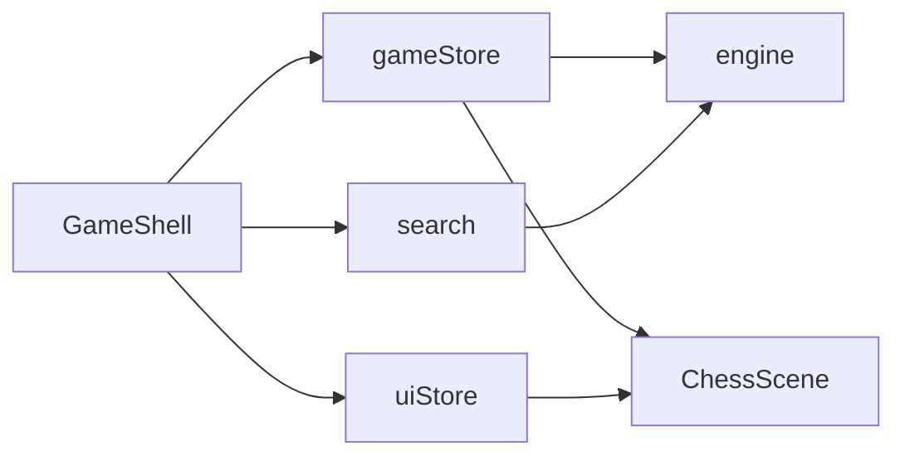

# Architecture

`GameShell` is the UI. `gameStore` holds the position. `engine` applies chess.js. `search` picks a computer move by calling the engine. `uiStore` holds preferences. `ChessScene` draws whatever the two stores currently say.

`GameShell` calls `useComputer`, and `useComputer` calls `chooseMove`. The scene never imports chess.js for a move. It reads piece instances and status from the store.

## Rules

`lib/chess/engine.ts` is the only module that applies a move. `lineChess` builds a `Chess` from `initialFen`, then replays `history` up to `cursor`. `playMove` returns `ok`, `promotion`, or `illegal`. A promotion with no piece chosen stays unplayed.

`statusFromLine` reports the side to move, check, and the ending. Mate, stalemate, and insufficient material are outcomes. They end the game. Threefold repetition and the fifty-move rule are claims. The player accepts with `claimDraw` or dismisses with `declineClaim`. The computer accepts a claim on its turn.

Components never hold a `Chess` instance. `lib/chess/pieceDiff.ts` is the other file that constructs one. `piecesFromFen` uses it to read the board and assign ids. Files that need `Square` or `PieceSymbol` import those types only.

## State

`lib/store/gameStore.ts` keeps serialisable data: `initialFen`, `history`, `cursor`, selection, keyboard focus, orientation, `pendingPromotion`, `thinking`, the computer's color, claim state, and the current `pieces` list. The redo stack is the tail of `history` past `cursor`. A new move slices that tail off.

`useGameView` derives the FEN, status label, PGN, captured material, and whether the scoresheet is browsing a past ply. Browsing is `cursor` behind the end of `history`.

`lib/store/uiStore.ts` keeps quality, coordinates, legal-move hints, reduced motion, opponent, the color you play, level, turn-the-board, scoresheet, and FEN/PGN visibility. Each setter writes the `grandmaster-ui` key. `hydrateUi` reads it on load. The game is not in that object.

## A move

Pointer and keyboard both land in the store. A click calls `selectOrMove`. A drag calls `moveBetween`. Arrow keys call `moveFocus`, and Enter calls `confirmFocus`. Esc and a click on empty space call `clearSelection`.

`commit` asks `playMove`. On `promotion` it sets `pendingPromotion` and waits for `choosePromotion`. On `ok` it appends the history move and refreshes `pieces`.

`locked` refuses input while `thinking` is set, a promotion dialog is open, an outcome is set, or a claim is recorded for the current FEN.

`facingSide` returns a side only when there is no computer and `turnBoard` is on. The orientation then matches the side to move. Against the computer, the camera stays on your side.

## Pieces

`piecesAt` walks the line and gives each piece a stable id, such as the first white pawn. `applyMove` slides that id, removes a capture, moves the rook on a castle, takes the passed pawn on en passant, and swaps the pawn id for a promoted piece. Meshes keep their identity across the animation.

`components/scene/Pieces.tsx` draws one instanced mesh per type and color, plus bishop slits. A move tweens the instance matrix for about 0.22s. With reduced motion, `samplePiece` snaps the piece to the square. The computer also replies immediately in that mode, instead of waiting 240ms. The same piece ids are used either way.

## Frame loop

`components/scene/ChessScene.tsx` sets `frameloop="demand"`. `BindScene` subscribes to both stores and calls `invalidate` on each change. `Pieces` calls `invalidate` again while a mesh is still sliding or a drag is active, so the canvas stays awake for the tween and then stops. `disposeAssets` runs when the canvas unmounts.

`ChessStage` does not render the canvas on the server. It shows a flat background until the client has mounted, then loads the scene.

Draw calls, triangles, and the idle-frame check are in [performance.md](performance.md). After a settled camera, an 800ms window added no frames. High and Balanced sit at 32 draw calls. Low, with shadows off, sits at 20.

## Computer

`computerColor` in `components/game/useComputer.ts` is the opposite of the color you chose. `null` means two players.

When it is that color's turn, the game is not over, the scoresheet is not browsing, and no promotion is pending, the hook sets `thinking` and waits 240ms (0ms if reduced motion is on). It then checks that the cursor and FEN are still the ones it saw. `chooseMove` returns a move, and `playReply` commits it through the same `commit` path as a human move.

`lib/chess/search.ts` is negamax with alpha-beta. Depth is 1, 2, or 3 for Easy, Medium, and Hard. The score is material (pawn 100 through queen 900) plus the number of legal moves, from the side to move. Captures are tried first. Hard also runs a capture-only quiescence search, two plies past the horizon. A small transposition table stores exact, lower, and upper bounds, keyed by the first four FEN fields.

Easy picks at random among moves that share the best score. Medium and Hard play the first of those tied moves. Mate in one is covered at every level in `lib/chess/search.test.ts`.

`plyStep` returns 2 when an undo or redo would land on a computer reply at the end of the line, so one button press takes back your move and the answer. In the middle of the line, or against a person, the step is one ply.

## Deploy and tests

`next.config.ts` exports a static site only when `GITHUB_PAGES=true`. That build turns `cacheComponents` and `partialPrefetching` off so Next.js can emit the `out` directory. The workflow is `.github/workflows/nextjs.yml`. Day-to-day `npm run build` keeps the normal Next server.

Unit tests sit next to the modules they cover:

- `lib/chess/engine.test.ts` covers squares, mate and draws, piece ids through castle, en passant, and promotion, and the store's undo, claim, and FEN import.
- `lib/chess/search.test.ts` covers promotion choices and mate in one.
- `lib/store/computer.test.ts` covers the reply and the two-ply undo.
- `components/game/GameShell.test.tsx` covers the shell.
- `components/scene/staunton.test.ts` covers the meshes.

`e2e/game.spec.ts` is the Playwright file. It drives scholar's mate, castling, promotion, undo, redo, restart, the phone dock, a computer answer to e4, and the idle draw-call budget.
